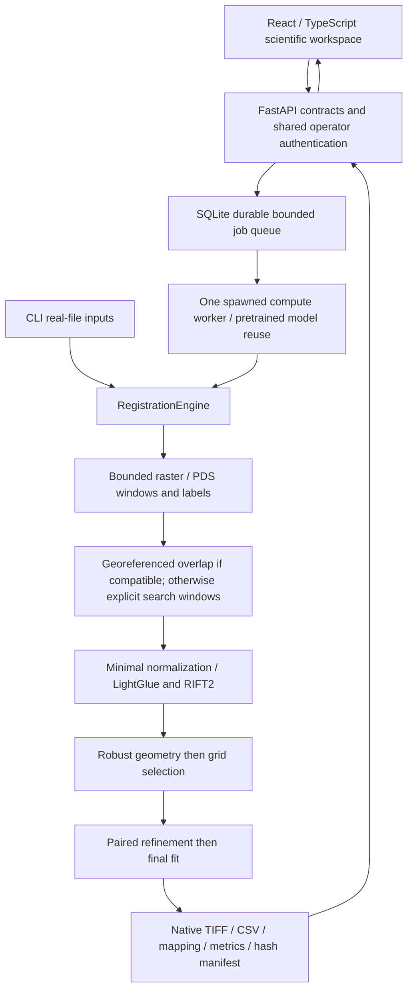

# Implemented architecture

The current default is ALIKED/LightGlue + parallel coarse RIFT2, affine MAGSAC++, 4×4 spatial selection and conservative bidirectional correlation refinement. Empty coarse RIFT2 results skip secondary guided-tile repeats within that run. Similarity uses RANSAC; affine/homography use MAGSAC++. There is no implemented LoFTR/OmniGlue/DINOv2 production path or TPS fallback.

The current raw OHRC/LRO pair uses explicit legacy windows and nominal GSD divisors. Its LRO EDR lacks geographic mapping; this path does not claim whole-scene geographic accuracy. Compatible projected rasters can derive overlap/GSD from declared CRS/affines. Camera-model/orbit reprojection across arbitrary mission products remains pending.

`transform.json` records native source→native reference and both processing→native frames, actual shapes, crop bounds, zero-based pixel centers and output georeferencing status. Science TIFF retains native radiometry; PNGs are normalized quicklooks. `support_mask.png` is a fit-point convex hull, not an uncertainty map. `candidates.npz` retains outliers as evidence. `manifest.json` is written last with artifact hashes.

A completed job means execution completed, not that the quality gate passed. The current scene is REJECT. Fit RMSE and external-control accuracy are separate fields. External controls never fit the transform. Cache identities include input, code, settings and pinned weights.

Operational scope: one API process, one spawned compute process, bounded outstanding jobs, local SQLite/storage and shared operator key. Cancellation/time limits are stage-boundary checks. No multi-tenant authorization, hard native-call watchdog, automatic retention, distributed GPU scheduler, or validated multi-host deployment is claimed.

Legacy modules remain for compatibility, but the supported API and CLI execution path is the shared engine. Historical showcase/configuration endpoints are deprecated and labeled unvalidated processing-coordinate data.
