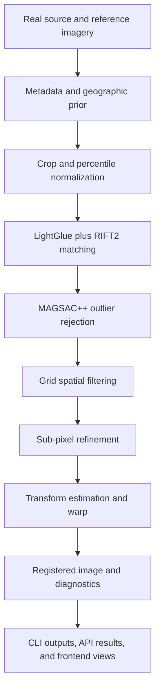

# LunarCV

LunarCV is a research-oriented software pipeline for registering real
Chandrayaan-2 optical imagery against reference imagery from NASA's Lunar
Reconnaissance Orbiter (LRO). It combines geographic metadata, image
normalization, feature matching, geometric outlier rejection, spatial
distribution checks, sub-pixel refinement, and registration diagnostics.

The repository contains a Python/FastAPI backend, a command-line registration
pipeline, a React/Vite visualization console, tests, evaluation metadata, and
small showcase products. It is a working project baseline, not a claim of
production-ready lunar georeferencing accuracy.

## Problem and Motivation

The same lunar surface can look substantially different across sensors because
of illumination, viewing geometry, ground sampling distance, and sensor
format. LunarCV is intended to make those cross-sensor correspondences
inspectable and reproducible while preserving the provenance of the imagery
and evaluation protocol.

## Current Capabilities

- Load and normalize supported PNG, JPEG, TIFF, and lunar `.img` imagery.
- Use calibrated OHRC geometry and LRO footprint metadata for a coarse spatial
  prior in the production script.
- Match image strips with LightGlue and the bundled RIFT2 implementation.
- Reject geometric outliers with OpenCV MAGSAC++.
- Enforce grid-based spatial coverage and refine selected correspondences with
  local sub-pixel correlation.
- Estimate affine, similarity, or homography transforms and write registered,
  overlay, checkerboard, correspondence, and metrics products.
- Expose upload, registration-job, image-listing, configuration, health, and
  result-file endpoints through FastAPI.
- Visualize the pipeline and existing result products in the React frontend.

## Architecture



The main implementation lives under `backend/lunarcv`. The FastAPI application
is under `backend/app`, the authoritative batch entry point is
`backend/scripts/register_pair.py`, and the browser console is under
`frontend/src`.

## Repository Layout

```text
backend/
  app/                  FastAPI application, routes, schemas, and services
  lunarcv/              Registration library and bundled RIFT2 code
  scripts/register_pair.py
                        Real-data batch registration entry point
  tests/                Backend-focused tests
data/
  metadata/             Evaluation manifest and geographic metadata
  results/              Small checked-in showcase products
  sample_pairs/         Small frontend/demo image pair
  raw/, processed/      Local data locations; ignored by Git
frontend/               React 19 + Vite visualization console
tests/                  Legacy top-level tests for modules under src/
Docs/                   Detailed architecture, setup, and evaluation notes
examples/               Python usage example
```

The untracked top-level `src/` directory contains older standalone helpers and
is not imported by the backend package. Review it before publishing or folding
it into the maintained package; it is intentionally not described as part of
the authoritative pipeline here.

## Prerequisites

- Python 3.11 or newer
- `uv` for the reproducible backend environment, or pip in an equivalent
  virtual environment
- Node.js 18 or newer and npm for the frontend
- Optional GPU support for Torch/LightGlue workloads
- Real source and reference imagery. Large raw products are not included in
  Git and must be acquired from their authoritative providers.

## Installation

Install the backend from the repository root:

```bash
cd backend
uv sync
```

Install frontend dependencies:

```bash
npm --prefix frontend install
```

The backend dependency lockfile is `backend/uv.lock`. The frontend lockfile is
`frontend/package-lock.json`.

## Configuration

Copy the example environment file when using the API locally:

```bash
cp .env.example .env
```

The supported settings currently include:

| Variable | Purpose | Default |
| --- | --- | --- |
| `BACKEND_CORS_ORIGINS` | Comma-separated browser origins | Local Vite/API origins |
| `MAX_UPLOAD_SIZE` | Maximum upload size in bytes | `1073741824` |
| `CLEANUP_AFTER_HOURS` | Result-retention setting | `24` |
| `VITE_API_URL` | Frontend API base URL | `http://localhost:8000/api/v1` |

The backend also has code-level defaults for storage paths under `data/` and
processing limits in `backend/app/config.py`.

## Run the API

From the repository root:

```bash
cd backend
uv run uvicorn app.main:app --reload --host 0.0.0.0 --port 8000
```

The interactive API description is available at
`http://localhost:8000/docs`. The API prefix is `/api/v1`; implemented routes
include `GET /health`, `POST /upload`, `GET /images`, `POST /register`,
`GET /jobs/{job_id}`, and `GET /jobs/{job_id}/results`.

## Run the Frontend

In another terminal:

```bash
npm --prefix frontend run dev
```

The Vite server normally uses `http://localhost:5173`. Set `VITE_API_URL` if
the backend is hosted elsewhere.

For a production bundle:

```bash
npm --prefix frontend run build
```

## Run a Registration

The production batch script expects the real OHRC and LRO files and the
calibrated geometry CSV configured by `backend/lunarcv/config.py`:

```bash
cd backend
uv run python scripts/register_pair.py
```

The script writes products to ignored local output directories, including a
registered image, overlay, checkerboard, correspondence CSV, metrics JSON,
and diagnostic figures. It may require substantial memory and compute for
full-resolution imagery. The small checked-in showcase under
`data/results/showcase_baseline_run/` is intended for inspection, not as a
representative production benchmark.

## Evaluation and Results

The checked-in manifest is at
`data/metadata/evaluation_manifest.json`. It requires held-out accuracy,
independent control-point provenance, and spatial-uniformity reporting; the
current pair explicitly records that independent ground truth is unavailable.

The checked-in showcase metrics are measured outputs from one baseline run:

| Metric | Value |
| --- | ---: |
| Candidate matches | 107 |
| Inlier matches | 6 |
| Inlier ratio | 0.0561 |
| Forward RMSE | 2.104 px |
| Backward RMSE | 2.258 px |
| Spatial-uniformity CV | 1.856 |
| Overlap | 82.40% |
| Execution time | 4.04 s |
| Quality decision | `REJECT (RMSE too high)` |

These are fit diagnostics, not independently validated accuracy claims. No
sub-pixel accuracy claim is made until independent real-image control points
are available. Published benchmark figures referenced by the project are
context only; they are not results produced by this repository.

## Tests and Verification

Backend tests can be run from the backend directory:

```bash
cd backend
uv run pytest
```

The frontend build and lint commands are:

```bash
npm --prefix frontend run build
npm --prefix frontend run lint
```

The legacy top-level tests are not part of the backend `pyproject.toml` test
configuration. They currently do not collect because they import standalone
`geo_prior` and `metadata` modules that are absent from the untracked `src/`
directory; treat this layout as legacy until it is intentionally reconciled.

## Data, Licensing, and Publication Notes

Do not commit raw mission imagery, local virtual environments, model caches, or
generated output directories. Check the redistribution terms for every
mission product, the LRO/SELENE source, the bundled RIFT2 code, LightGlue,
the benchmark paper, and all frontend assets before making a public release.
The repository currently has no root `LICENSE` file, so no license is implied
for the project. Choose and add one only after confirming the rights holder and
the licenses of redistributed components.

## Limitations and Next Steps

- Independent ground truth and cross-sensor control-point validation are still
  pending for the evaluation pair.
- The checked-in showcase is rejected by its own quality gate.
- Full-resolution `.img` workflows depend on local data acquisition and can be
  resource intensive.
- The API currently runs registration work through the application service;
  production deployment needs stronger job isolation, authentication, and
  resource controls.
- The standalone top-level `src/` helpers and legacy tests need an explicit
  maintenance decision.

Planned work is documented in `Docs/03_project_goals_and_submission.md` and
`Docs/evaluation_protocol.md`, with emphasis on real-data validation,
independent control points, reproducible benchmarks, and better job handling.

## Acknowledgements

The project builds on OpenCV, PyTorch, LightGlue, the RIFT2 implementation
bundled in this repository, FastAPI, React, and Vite. See the dependency
manifests and `Docs/02_key_findings_and_references.md` for source-specific
references.
